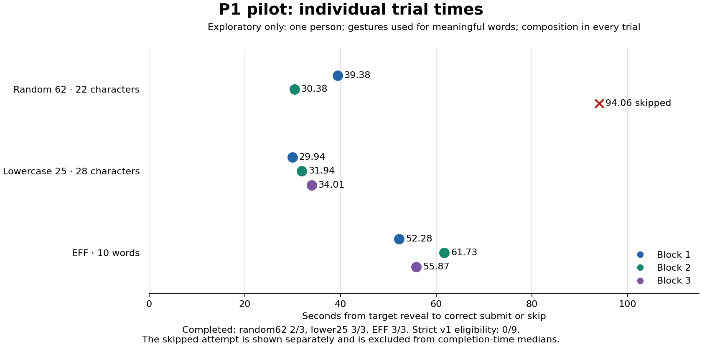

# Пилот P1 на телефоне · наблюдения и исправление протокола

[English](pilot-p1.md). Файл получен и проанализирован 31.10.2026. **Это описательные наблюдения, не контролируемое сравнение форматов.** Один участник прошёл всю сессию v1. Все девять измеряемых попыток имеют `composition`; после выгрузки участник подтвердил, что жестовый ввод был включён и использовался на осмысленных словах. Влияние формата смешано с влиянием способа ввода. Эти числа нельзя называть ускорением, результатом только ручных нажатий или выводом для всех пользователей.

## Источник и фактические условия

Источник — переданный владельцем `mobile-input-v1-p1.json`, 6663 байта, SHA-256 `21d309a639e028f133417972ff49b3274a1785a4c67b5453e44a3fa72b76e163`. Протокол `mobile-input-v1`, сборка `558f6d14f00c2ef37037d1cbf0071c57e511ed338e588249bda8b7448a4b6bc9`, участник 1. Оригинал сохранён без изменений вне Git. Здесь опубликованы только [таблица измеряемых наблюдений](pilot-p1-observations.csv) и выводы; образцов и введённых строк в таблице нет.

Условия из самоотчёта: Realme GT7, Android 16, Chrome 156.0.8078.75, Яндекс.Клавиатура 109.16, English QWERTY, один большой палец, вертикальная ориентация, базовое знакомство с английским. Версии и настройки не проверялись непосредственно на устройстве. После передачи файла участник сообщил: «там где были осмысленные слова, использовал жесты». Точные номера попыток со свайпами и состояние остальных помощников v1 не записывал; способ каждой попытки не восстанавливается по числу событий. Абсолютного времени начала/конца в JSON нет: дата получения не доказывает дату выполнения.

Проверка схемы успешна: предусмотренный порядок участника 1, уникальные индексы 0–11, три тренировки и девять измерений, все оценки заполнены, пропущенных или повторных записей нет, длины/энтропия/время/статусы согласованы, отпечаток совпадает с выданной сборкой. Восемь измеряемых попыток завершены правильно, одна пропущена, тайм-аутов нет. Единственная отметка во всех измерениях — `composition`. Отсутствие отметок вставки, фона, замены и скрипта не доказывает отсутствие помощи клавиатуры.

## Исходный результат и описательный расчёт

**Основная выборка по исходному v1 пуста:** заранее установленное правило исключает любую отметку, включая composition. Допустимых попыток 0/9, основных медиан и оценки частоты ошибок нет. Правило и исходный файл не изменены; анализатор теперь явно показывает пустую выборку и сохраняет рядом фактически наблюдаемые успехи/пропуски.

Ниже — отдельный **последующий расчёт с допуском одной composition**. Включены все три измеряемые попытки каждого формата; медиана времени вычисляется только по успешным завершениям. Таблица описывает произошедшее при смешанных способах ввода, а не задуманный опыт только с нажатиями.

| Формат | Успехи / записано | Медиана успешного завершения | Ошибка первой отправки / попытки с отправкой | Неверных отправок | Медиана удобства, 1–7 |
| --- | --- | --- | --- | --- | --- |
| random62, 22 символа | 2/3; один пропуск | 34,88 с, n=2 | 1/3 | 3 | 4 |
| lower25, 28 символов | 3/3 | 31,94 с, n=3 | 0/3 | 0 | 5 |
| EFF, 10 слов | 3/3 | 55,87 с, n=3 | 1/3 | 3 | 4 |

Оценка удобства учитывает пропущенную попытку; медиана времени — нет. Пропущенная random62 закончилась на 94,06 с после трёх неверных отправок; расстояние редактирования первого ответа — 2. Это не правильное завершение и не тайм-аут. В одной EFF-попытке было три неверных отправки, затем успех на 61,73 с; расстояние первого ответа — 1. Неверная отправка не равна одной опечатке.

По блокам тоже нет устойчивого ранжирования: в первом lower25 занял 29,94 с против 39,38 с у random62, во втором — 31,94 с против 30,38 с. В третьем контроль пропущен. Медиана контроля отбирает два успеха, остальных — три, что создаёт различие отбора. Общий процент ускорения и тест значимости здесь не обоснованы. Длины фраз EFF составили 76, 77 и 86 символов; базовое знание английского и жесты на осмысленных словах дополнительно мешают выделить эффект формата.

Самооценка переключений: 10/15/5 для random62, 0/неизвестно/неизвестно для lower25, неизвестно во всех измеряемых EFF. Пропуски значений не равны нулю. События ввода не равны нажатиям: например, 86-символьная фраза дала 71 событие; IME может передавать группы символов, поэтому из этого нельзя определить количество или место жестов.

## Изменения для следующего опыта

Правило v1 оказалось слишком широким для мобильного инструмента: composition описывает работу метода ввода, не специально автокоррекцию. См. [W3C UI Events](https://www.w3.org/TR/uievents/#events-compositionevents) и [IME](https://www.w3.org/TR/uievents/#keys-IME). Это не устанавливает причину каждого события в файле; использование жестов независимо подтверждено участником.

В v2 перед стартом отдельно записываются «выключено/включено/не знаю» для автокоррекции, подсказок и жестов; при любом ответе кроме «выключено» опыт не начинается. После каждой попытки записывается «нажатия/помощь/неизвестно». Composition сохраняется информационно; для основной выборки нужны выключенные настройки, заявленные нажатия и отсутствие остальных отметок. Это самоотчёт, не проверка ОС. К v1 по-прежнему применяется правило v1 и отдельно выдаётся диагностический расчёт. Разные версии/сборки не объединяются. Генераторы, энтропия, порядок и таймеры не изменены.

Следующее необходимое свидетельство — свежая сессия v2 на том же телефоне с отключённой помощью и отдельными нажатиями; номер участника остаётся 1. Она анализируется отдельно от пилота: повторы одним человеком не увеличивают число независимых участников. Для фраз со свайпами можно позже задать другой протокол с явным распределением способов ввода. Этап ③ остаётся открытым для контролируемого сравнения; этот пилот уже обнаружил недостаток инструмента и реальный выбор способа ввода.

## Воспроизведение и проверка

Выполните `npm run study:build`, затем `node scripts/analyze-study.cjs /path/to/mobile-input-v1-p1.json`. В `conditions` должно быть 0 допустимых наблюдений и пустые медианы; `compositionSensitivity.conditions` даёт таблицу выше. Анализатор записывает SHA-256 источника и версию анализа, не изменяя файл. `p1-analysis.json` сохранён локально вне Git.

Числа независимо пересчитаны по исходному JSON через Python `statistics.median`, фильтры статуса и суммы, а не только TypeScript-функцией. CSV сохраняет измеряемые значения для воспроизведения без полной выгрузки. `python3 research/mobile-input/results/plot-pilot.py` строит график с Matplotlib; эта необязательная зависимость анализа не затрагивает npm-пакет. Публичный API и распределения паролей не менялись. Регрессионные проверки покрывают сохранение v1, отдельную чувствительность к composition, остальные исключения, настройки/способы v2, схемы и браузерный экспорт. Фактический удалённый CI фиксируется отдельно в PR и карточке Notion.

Локально на Node 24.19.0/npm 11.9.0 прошли: `npm test` (273 теста, девять наборов), `npm run study:build`, `STUDY_CHROMIUM_PATH=/usr/bin/chromium npm run test:study` (шесть проверок браузера/анализатора), `npm run test:package` (чистая установка tarball) и `git diff --check`. PNG проверен визуально. Публикации npm и тега релиза не было.
